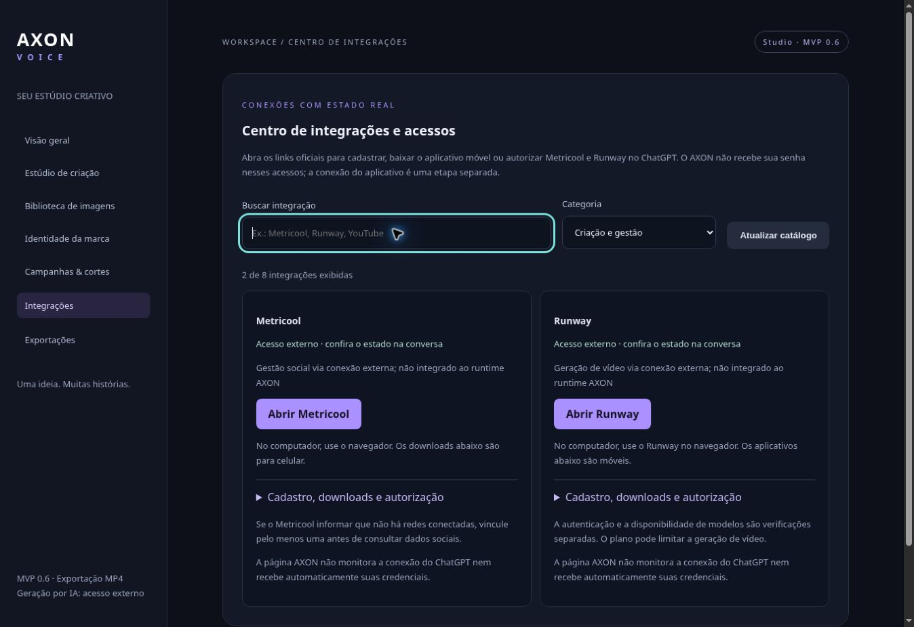

# Organização da plataforma — versão 0.6

## Áreas de trabalho

| Área | Endereço local | Objetivo |
| --- | --- | --- |
| Visão geral | /overview | Contagens reais do estúdio e campanhas recentes |
| Estúdio | /studio | Roteiro, cenas, imagens selecionadas, áudio e exportação |
| Biblioteca | /library | Imagens autorizadas e seus metadados |
| Marca | /brand | Identidade editorial para novas campanhas |
| Campanhas | /campaigns | Textos por rede, cortes, revisão e briefs |
| Integrações | /integrations | Busca, categorias e acessos oficiais |
| Exportações | /exports | Trabalhos em fila e downloads de MP4 |

Com o servidor iniciado, abra `http://127.0.0.1:3000/integrations` para ir diretamente ao centro. Esses endereços são locais à máquina onde o servidor está executando; não são URLs públicas de hospedagem.

A interface mostra uma área por vez. A navegação usa fragmentos para preservar o conteúdo já carregado e atualiza título, foco e item atual do menu. Links antigos `#editor`, `#result` e `#scenes` continuam abrindo o Estúdio. O botão Voltar do navegador acompanha as mudanças de fragmento.

## Visão geral

As contagens vêm de `/api/workspace` e refletem os dados da instância: campanhas, imagens, vídeos prontos e trabalhos pendentes. Não são métricas de audiência ou números ilustrativos. Campanhas recentes abrem sua revisão persistida. O projeto em edição continua no navegador, como nas versões anteriores.

## Centro de integrações

Metricool e Runway aparecem primeiro, seguidos de automação e pacotes para redes sociais. A busca ignora diferenças de maiúsculas e acentos; categorias separam criação/gestão, automação e pacotes sociais. Cadastro, downloads e autorização ficam em painéis recolhíveis. Links de acesso abrem o site oficial em outra aba.

A integração de automação tem acesso às instruções em `/guides/automation`, sem expor segredos configurados. Conexões no ChatGPT continuam separadas do runtime AXON; os cartões não inventam um estado de autenticação.

## Verificação visual

A versão 0.6 foi aberta no navegador de revisão, incluindo a visão geral e o Estúdio. Foram verificados a busca por Runway, o filtro de criação/gestão e o planejamento de um roteiro demonstrativo. A prévia local depende do ambiente continuar em execução.

